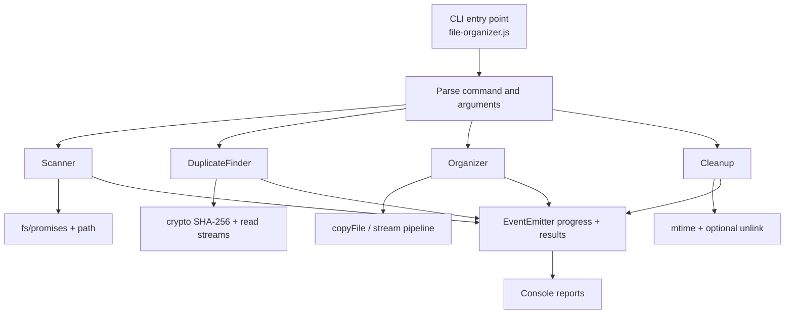

<div align="center">

# File Organizer

**A modular Node.js CLI for file analysis, duplicate detection, organization, and safe cleanup.**

[](https://nodejs.org/)


[Features](#features) · [Architecture](#architecture-at-a-glance) · [Getting started](#getting-started) · [Commands](#commands) · [Project structure](#project-structure)

</div>

---

## Overview

**File Organizer** is a command-line application built with Node.js to bring order to crowded directories. It recursively scans files, identifies duplicates by content, copies files into categorized folders, and previews or deletes outdated files.

The project demonstrates **asynchronous file system operations, ES modules, EventEmitter, streams, SHA-256 hashing, and defensive error handling** using Node.js built-in modules. No third-party dependencies are required.

## Features

| Feature | What it does |
| --- | --- |
| **Directory analysis** | Recursively scans files and reports totals, size, file types, age distribution, largest files, and the oldest file |
| **Duplicate detection** | Uses SHA-256 hashes to find identical content, even when filenames differ |
| **File organization** | Copies files into `Documents`, `Images`, `Archives`, `Code`, `Videos`, and `Other` |
| **Collision protection** | Preserves existing destinations using names such as `report(1).pdf` |
| **Large-file support** | Copies files of **10 MB or more** using streams and `pipeline()` |
| **Safe cleanup** | Previews old files by default; deletion requires an explicit `--confirm` flag |
| **Event-driven progress** | Emits events for scanning, hashing, copying, and deleting files |

## Architecture at a glance



Each command is implemented as a class that extends `EventEmitter`. File-processing logic lives in `lib/`, while the entry point handles command-line arguments and console output.

## Tech stack

| Area | Technology |
| --- | --- |
| Runtime | Node.js 20+ |
| Language | JavaScript (ES modules) |
| File system | `node:fs`, `node:fs/promises` |
| Paths | `node:path` |
| Hashing | `node:crypto` — SHA-256 |
| Streaming | `createReadStream()`, `createWriteStream()`, `pipeline()` |
| Events | `node:events` — `EventEmitter` |
| Dependencies | Node.js built-in modules only |

## Getting started

**Requirements:** Node.js 20 or later and a terminal (Git Bash, PowerShell, or Command Prompt).

```bash
git clone https://github.com/Larimar4you/file-organizer.git
cd file-organizer
```

No `npm install` step is necessary because this project has no external dependencies.

For a quick check, scan the current directory:

```bash
node file-organizer.js scan .
```

> **Tip:** Test destructive commands on a dedicated sample folder, not on your real Downloads directory.

## Commands

| Command | Purpose | Required arguments |
| --- | --- | --- |
| `scan` | Analyze file statistics | `<directory>` |
| `duplicates` | Find files with identical contents | `<directory>` |
| `organize` | Copy files into categorized folders | `<directory> --output <directory>` |
| `cleanup` | Preview or remove outdated files | `<directory> --older-than <days> [--confirm]` |

### 1. Scan — directory insights

```bash
node file-organizer.js scan ./sample-files
```

Recursively analyzes the selected directory and displays file counts, combined size, grouping by extension, age distribution (last 7 days, last 30 days, older than 90 days), the three largest files, and the oldest file.

### 2. Duplicates — content-based matching

```bash
node file-organizer.js duplicates ./sample-files
```

Uses a **SHA-256 hash** computed from a readable stream, rather than comparing filenames. Reports groups of matching files, their paths and hashes, and the disk space occupied by extra copies.

**Wasted space** is calculated as `file size × (number of copies − 1)` for each duplicate group.

### 3. Organize — copy without overwriting

```bash
node file-organizer.js organize ./sample-files --output ./sorted-files
```

Files are copied into these categories:

| Category | Example extensions |
| --- | --- |
| Documents | `.pdf`, `.docx`, `.txt`, `.md`, `.xlsx` |
| Images | `.jpg`, `.png`, `.svg`, `.webp` |
| Archives | `.zip`, `.tar`, `.gz`, `.7z` |
| Code | `.js`, `.py`, `.html`, `.css`, `.json` |
| Videos | `.mp4`, `.mov`, `.mkv`, `.webm` |
| Other | Unrecognized extensions |

Original files remain in the source directory. Existing destination names are preserved by appending numeric suffixes, for example `photo.jpg` → `photo(1).jpg`.

Files **smaller than 10 MB** use `fs.copyFile()`. Files **10 MB or larger** are copied with streams using `pipeline()`.

### 4. Cleanup — preview before deletion

Preview files modified more than 90 days ago:

```bash
node file-organizer.js cleanup ./sample-files --older-than 90
```

This is the default **dry-run mode**: it lists matching files and their sizes without deleting anything.

To actually remove matching files:

```bash
node file-organizer.js cleanup ./sample-files --older-than 90 --confirm
```

> [!CAUTION]
> `--confirm` **permanently deletes** the matching files. There is no recycle-bin or undo step. Always inspect the dry-run output first, and use a test directory when trying the command for the first time.

## Project structure

```text
file-organizer/
├── lib/
│   ├── scanner.js        # Recursive analysis and file statistics
│   ├── duplicates.js     # SHA-256 hashing and duplicate groups
│   ├── organizer.js      # Category-based copying and name conflicts
│   └── cleanup.js        # File age filtering and optional deletion
├── file-organizer.js     # CLI entry point and console output
├── package.json          # ES module configuration and npm scripts
├── .gitignore            # Excluded local and test files
└── README.md             # Documentation
```

## Error handling and safety

- File operations use `try/catch` and report failures through specific error messages or command events.
- Common file system errors include `ENOENT` (not found), `EACCES` (access denied), and `EPERM` (operation not permitted).
- The `.git` directory is excluded from the implemented directory-processing workflows.
- `organize` copies rather than moves source files, and handles duplicate destination filenames.
- `cleanup` defaults to dry run and requires `--confirm` for deletion.

## Author

**Lara Kosta** — [GitHub: Larimar4you](https://github.com/Larimar4you)
